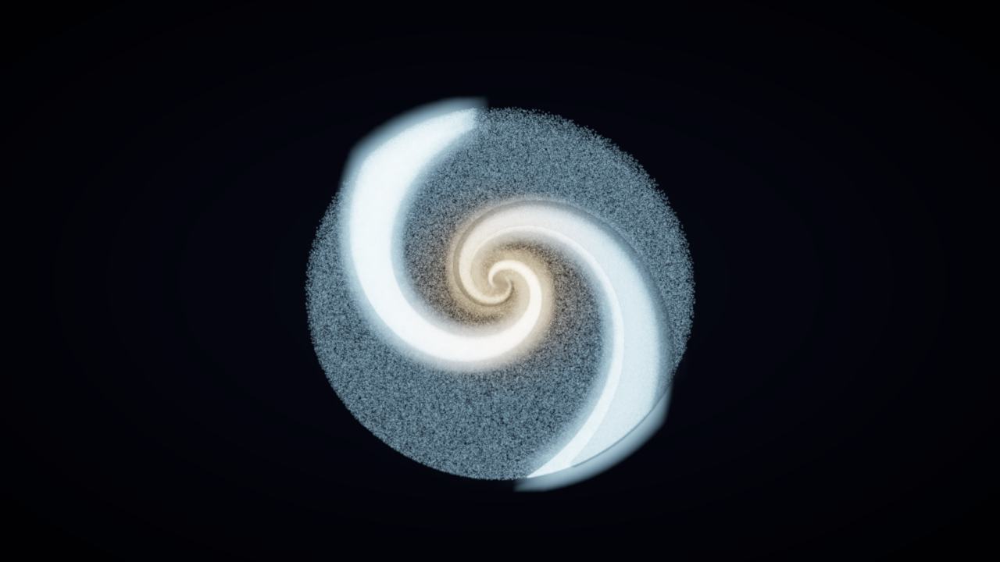

# QDM-NS Galaxy

`cargo run` opens a spiral galaxy on the GPU: by default **1,048,576** stars, integrated in a compute shader and drawn as soft glowing sprites with HDR bloom. The force law is the same one as the CPU loop in [`src/galaxy.rs`](src/galaxy.rs): a fixed Plummer core, a light black hole on a dragging orbit, a MOND boost on `|a_core + a_BH|`, and a flared disk wound into a two-arm logarithmic spiral. `--cpu` integrates that loop on the CPU and only uses the GPU to draw. `--headless` is the older CPU sampler and does not open a window.

The equations the model is aiming at are in [THEORY.md](THEORY.md). What the loop integrates, and the 60,000-particle measurements behind the table below, are in [REVIEW.md](REVIEW.md).



## Forces

Each substep, for every star:

1. Newtonian Plummer acceleration of the core (`GM = 4000`, `ε = 8`) at the star's 3D distance from the origin.
2. Newtonian Plummer acceleration of the black hole (`GM = 360`, `ε = 20`) at the 3D separation. `|a_BH|` is capped at 8.
3. When MOND is on, those two accelerations are summed and the magnitude is multiplied by the simple interpolating function. The direction stays Newtonian.
4. A vertical spring. With the vortex flag, an eye-wall updraft is added afterwards. The spring and the updraft are not part of the MOND input.
5. With the vortex flag, an inward acceleration `0.035 · v_c² / r`.
6. A two-arm pinch, `sin(2 · phase)` at `0.001/s`, on a pattern rotating at `0.07 rad/s`. The arm locus is `θ = (2π/φ²) ln r` (pitch about 22.6°).
7. In-plane damping of `0.001/s`.

Tangential speed is whatever those accelerations produce. Stars are born on the midplane circular speed of the core, `sqrt(a_r · r)`. Nothing in the step relaxes `v` back onto that curve.

`--legacy` ignores the flags below and runs the earlier law: 6%/s damping, a one-arm `sin(phase)` pinch, a razor-thin disk (`|y| ≤ 2.5`, `vy = 0`), and a small extra twist of the velocity vector.

## MOND

```
a = a_N · (½ + √(¼ + a0 / a_N))
```

In the deep regime this is `a ≈ √(a_N · a0)`, so `v⁴ → GM · a0`. The default scale is `a0 = 1` in **simulation units** (`DEFAULT_A0` in `src/galaxy.rs`). With `GM = 4000` the asymptote is `v∞ = (GM · a0)^(1/4) ≈ 7.95`. At r = 195 the Plummer field is not fully in that regime, so the midplane circular speed is about 8.6. This `a0` is the code-unit knob, not Milgrom's SI value `1.2×10⁻¹⁰ m/s²`.

| Flag | Default | Effect |
|---|---|---|
| `--mond` / `--no-mond` | on | Boost on or off. |
| `--a0 <float>` | `1` | Simulation-unit scale. Negative values are clamped to 0. |
| `--vortex` / `--no-vortex` | on | Flared disk, seeded vertical speed, spring `k = 0.10`, eye-wall updraft, inflow, rotating two-arm pattern. |
| `--legacy` | off | Earlier integrator. Ignores `--mond`, `--no-mond`, `--a0`, and `--vortex`. |

`M` toggles MOND while the window is open. With `--legacy` the key prints a notice and leaves the force law alone.

## Vortex

The default disk is born with half-thickness `h = 8 + 18·(r/R)` and a vertical speed of that order. The updraft peaks at cylindrical radius 34 and turns over near `|y| = 36`. Vertical damping is a quarter of the in-plane rate, so the layer keeps an rms height of order 14 over a 40 s run. `--no-vortex` drops the flare, the updraft, and the inflow, and uses the stiffer spring.

## Measured rotation curve

Headless release run, 60,000 particles, seed 1, `dt = 1/60`, 40 s. `v_N` and `v_M` are midplane circular speeds of the core. They are labels on the bins, not values the integrator is steering toward.

| | legacy | vortex only (`--no-mond`) | MOND + vortex (default) |
|---|---:|---:|---:|
| rms height √⟨y²⟩ | 0.20 | 14.8 | 13.8 |
| v_θ at r ≈ 52 | 2.93 | 7.98 (v_N 8.58) | 8.64 (v_M 10.44) |
| v_θ at r ≈ 195 | 1.41 | 4.61 (v_N 4.52) | 9.51 (v_M 8.62) |
| v(195) / v(52.5) | 0.48 | 0.58 | 1.10 |

With MOND off, speed from r ≈ 70 outward stays on the falling Plummer curve. With MOND on, v_θ from r ≈ 90 to r ≈ 195 stays between 9.4 and 9.5. The ratio 1.10 is flatter than the analytic midplane ratio 0.83, because the r ≈ 52 bin sits in the eye wall and runs slow, and the outer disk runs about 10% above 8.62. Full bins and plots are in [REVIEW.md](REVIEW.md).

## Window

The default camera is an orbit, tilted **18°** from face-on, distance 820, looking at `(0, 4, 0)`. Yaw, tilt, and distance ease toward the target each frame. Sprites are camera-facing quads in clip space, a few pixels across, larger near the core and when the camera moves in. They blend additively into an HDR buffer. A bright-pass and three Kawase blurs feed a Reinhard composite. One star in eight is a faint dust lane, drawn behind the arms and used as a soft extinction mask. `--no-dust` turns that mask off.

Color runs from a warm gold core to blue in the outer arms, brighter where the star is faster and where it sits on the spiral.

| Input | Action |
|---|---|
| Left drag | Orbit yaw and tilt |
| Scroll, `W` / `S` | Zoom |
| `A` / `D` | Yaw |
| `Q` / `E` | Tilt |
| `R` | Reset the orbit |
| `M` | Toggle MOND |
| `Escape` | Quit |

| Flag | Default | Effect |
|---|---|---|
| `--stars <n>` | 1048576 | Particle count. Values under 64 are raised to 64. |
| `--cpu` | off | Integrate in `galaxy.rs` and upload the buffer each frame. Slow at a million stars; `--stars 60000` is the useful CPU size. |
| `--seed <u64>` | 1 | Initial disk. GPU respawn uses a hash of index, seed, and frame, so a single respawn does not match the CPU `StdRng`, and the binned curve still does. |
| `--no-dust` | dust on | Skip the dust-lane mask. |
| `--shot <path>` | | Write one offscreen PNG and exit. No window. |
| `--benchmark <frames>` | | Print compute-only fps and full-frame fps, then exit. |
| `--width` / `--height` | 1280×720 | Offscreen size. The window uses the same numbers as its initial size. |

`--no-mond`, `--a0`, `--vortex`, `--no-vortex`, and `--legacy` apply to both the GPU kernel and `--cpu`.

On llvmpipe (software Vulkan, no discrete GPU in this environment) at 1,048,576 stars and 1280×720 the compute shader ran at about **52 fps** (19 ms). A full frame, including the sprite and bloom passes, was about **1.3 fps** (780 ms). The sprites are the fill-rate cost; a hardware GPU is what that pass is sized for.

## GPU and CPU agree

`gpu_kernel_matches_cpu_curve_and_thickness` spawns 4096 stars from the same seed, steps both integrators for 3 s at `dt = 1/60`, and compares `curve_check` (v_θ in the r = 45–60 and r = 170–220 bins, plus rms height). Release, seed 11, llvmpipe:

| | ratio v(195)/v(52) | v_θ(195) | rms y |
|---|---:|---:|---:|
| MOND CPU | 0.8233 | 8.685 | 11.692 |
| MOND GPU | 0.8233 | 8.685 | 11.695 |
| Newtonian CPU | 0.5270 | 4.521 | 11.766 |
| Newtonian GPU | 0.5269 | 4.521 | 11.765 |

That is well inside a few percent (the outer-bin counts differed by 2 stars in the Newtonian run). The 40 s, 60,000-star curves above remain the CPU reference; the GPU kernel is the same force order, including `--legacy`.

## Build and run

Rust **1.88** or newer. The crate is `edition = "2024"` and `Cargo.toml` sets `rust-version = "1.88"`. The window needs a GPU (or lavapipe) and a display. `--headless`, `--shot`, and `--benchmark` do not.

```bash
cargo build --release
cargo run --release

cargo run --release -- --stars 1048576
cargo run --release -- --no-mond
cargo run --release -- --a0 0.3
cargo run --release -- --no-vortex
cargo run --release -- --legacy
cargo run --release -- --cpu --stars 60000

cargo run --release -- --shot docs/img/galaxy_gpu.png --stars 1048576
cargo run --release -- --benchmark 30 --stars 1048576
```

### Headless

Prints the rotation curve and disk thickness, and writes a CSV. No window.

```bash
cargo run --release -- --headless --seconds 40 --particles 60000 --seed 1 \
    --out analysis/review_data/modern_curve.csv

cargo run --release -- --headless --legacy --seconds 40 --particles 60000 --seed 1 \
    --out analysis/review_data/legacy_curve.csv

cargo run --release -- --headless --no-mond --seconds 40 --particles 60000 --seed 1 \
    --out analysis/review_data/vortex_only_curve.csv
```

| Flag | Default |
|---|---|
| `--seconds` | 40 |
| `--particles` | 60000 |
| `--dt` | 1/60 |
| `--seed` | 1, used for the initial disk and for respawn |
| `--out` | `galaxy_curve.csv` |
| `--snapshot-dir` | unset. If set, writes `t0.csv` and `t_end.csv` with columns `x,y,z` |

Samples land on t = 0, 5, 10, 20, 40, … up to `--seconds`, plus the final time. `analysis/review_data/` is gitignored. `python3 analysis/plot_galaxy_review.py` redraws the figures in `docs/img/` from those CSVs.

```bash
cargo test --release
cargo clippy --release -- -D warnings
```

## What is compiled

```
src/main.rs                         window, or --shot / --benchmark / --headless
src/galaxy.rs                       CPU force law, particle struct, and the --cpu path
src/gpu_galaxy.rs                   wgpu compute, sprites, bloom, orbit camera
src/headless.rs                     CPU rotation-curve sampler
src/quaternion/                     FluxQuaternion; look_at builds the view matrix
src/engine/                         keyboard state
assets/shaders/galaxy_compute.wgsl  port of update_particles and the legacy step
assets/shaders/galaxy_sprite.wgsl   soft point sprites (color is computed here)
assets/shaders/galaxy_bloom.wgsl    bright-pass, Kawase blur, tonemap
```

The camera orientation is a quaternion (`q v q⁻¹`). The view and projection matrices are the pair the sprite shader multiplies. A star's velocity is the vector part of a `FluxQuaternion` on the CPU; the GPU buffer stores `pos.xyz`, a dust flag in `pos.w`, and `vel.xyzw`.

The older Bevy galaxy (`src/simulation/`, including its debug gizmo), the second `FluxQuaternion` in `src/physics/`, the 1-pixel point renderer, and the shaders that belonged to those paths have been removed. They implemented a different force law from `src/galaxy.rs`. [REVIEW.md](REVIEW.md) and [THEORY.md](THEORY.md) still describe that older code as it was when those notes were written.

## Dependencies

- `winit` 0.30 — window and input
- `wgpu` 22 — compute and the sprite/bloom passes
- `bytemuck` — buffer casts
- `pollster` — GPU init
- `png` 0.17 — `--shot`
- `rand` 0.8 — disk initialisation and CPU respawn
- `env_logger` / `log`
