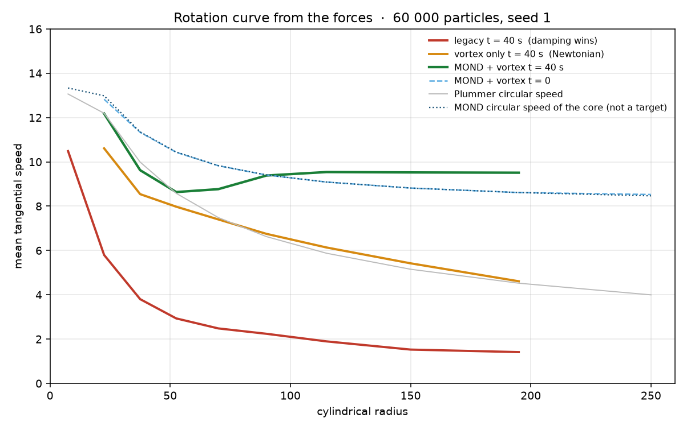
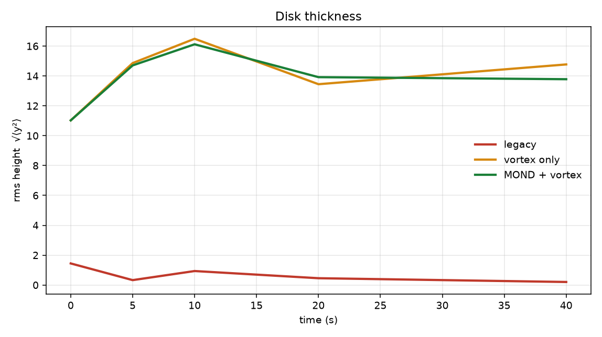
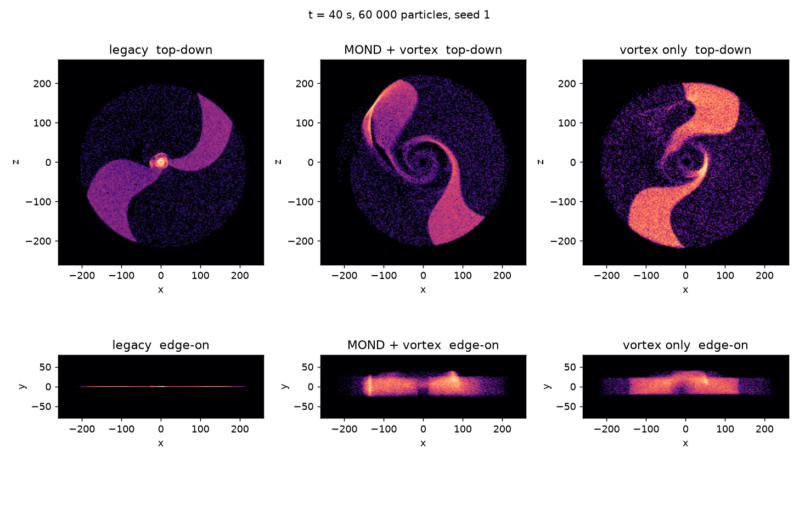

# Code review: QDM-NS galaxy simulation

Line numbers below refer to `fix/math-and-theory-doc` at `3db9727`, the parent of this branch. The running program is `src/main.rs` → `src/galaxy.rs` → `src/hurricane_3d/renderer.rs`. The Bevy code under `src/simulation/` and the compute shaders are not part of the build (`bevy` is commented out in `Cargo.toml`, and `main.rs` never declares `mod simulation`).

Measurements are from a headless integrator added on this branch (`--headless`). The **legacy** column is the force law and the initial disk from the parent branch, byte-for-byte in `update_particles_legacy`, run with a fixed seed so the before/after comparison is the same 60 000 particles. See [Measured rotation curve and thickness](#measured-rotation-curve-and-thickness).

---

## Why it's flat and not a hurricane

The window on your screenshot is this program (`QDM-NS Galaxy — Black Hole Through Space Fluid`). What it draws is a razor-thin sheet of points, viewed from above, with no vertical circulation. Several independent choices stack:

1. **The disk is born flat.** Stars are placed with `|y| ≤ 2.5` (`DISK_THICKNESS = 5`, `src/galaxy.rs:53` and `:120`) inside a disk of radius 260, and `vy` is set to 0 (`src/galaxy.rs:129`). The rms height of that distribution is 1.44 code units. A hurricane's eye wall is a large fraction of its radius; this sheet is about half a percent.

2. **A stiff spring then crushes what little height there is.** Every substep adds `ay -= y * 0.8` (`VERTICAL_K`, `src/galaxy.rs:43` and `:334-335`). That is a harmonic oscillator with period ≈ 7 s, aimed at `y = 0`.

3. **Damping removes the vertical velocity before the spring can oscillate.** Velocity is multiplied by `1 - 0.06 * dt` (`src/galaxy.rs:357-362`), including `vy`. Measured rms height falls from **1.45 at t = 0 to 0.20 at t = 40 s**. By then 90% of the stars sit inside `|y| < 0.27`.

4. **Nothing in the live force law makes a vortex.** There is no radial inflow, no eye-wall updraft, and no downdraft. The old hurricane model (`src/simulation/hurricane.rs`) had a pressure gradient, a Rankine wind profile and a Coriolis deflection, and it is not compiled. The ansatz `v(r, φ) = ω(r) k̂ + φ₀ ln r` is not what the live particles get. They get a purely horizontal circular velocity. The `φ₀ ln r` term is stored as a vertical velocity only in the unused Bevy initialiser (`src/simulation/gpu_galaxy.rs:178-188`), where it is large enough (`φ₀ ln r` ≈ 2–10) to throw particles out of the disk in a straight line rather than circulate them.

5. **The "arm" force does not build a spiral you can watch rotate.** It is a tangential acceleration `−sin(θ − φ₀ ln r) · v · 0.05` (`src/galaxy.rs:347-354`). For a two-arm spiral the stable equilibria of `sin(phase)` are `phase = 2πk` only; the arm you placed at offset π (`src/galaxy.rs:106-110`) is an unstable point and stars leave it. The locus itself does not rotate, so holding a star on it means cancelling its orbital motion. The coefficient 0.05 is too weak to do that against differential rotation, and too weak to keep a density wave. Stars are painted onto the spiral at t = 0 (arm contrast 0.91) and then shear. Outer stars also fade: alpha falls to a floor of 0.04 (`src/galaxy.rs:458`), so the outer disk, where a spiral would be easiest to see, is nearly invisible.

6. **The camera and the point shader hide the third dimension.** Startup calls `camera.rotate(0.0, 18.0)` (`src/main.rs:43`). `rotate` treats its arguments as mouse pixels and multiplies by `look_sensitivity = 0.002` (`src/quaternion/camera.rs:56-58`), so that call pitches the camera by **0.036 rad (2°)**, not 18°. The camera sits at `(0, 220, 380)` looking almost horizontally, and the disk is a sheet in the x–z plane. The vertex shader accepts a `size` attribute and never uses it (`assets/shaders/particle3d.wgsl:15` and `:24-29`); points stay 1 pixel. There is no depth buffer (`src/hurricane_3d/renderer.rs:143`). Additive blending (`renderer.rs:128-131`) turns overlapping points into a smooth smear. A 1-pixel sheet with no depth, seen face-on, cannot read as a hurricane even if a few particles have a little `y`.

The dark center in the screenshot is the inner cutoff, not an eye wall. Stars spawn at `r ≥ 8` (`src/galaxy.rs:101`) and any star within 15 of the black hole is deleted and respawned outside (`BH_ABSORB_R`, `src/galaxy.rs:48` and `:415`). At t = 0 the bin `r < 15` holds 68 of 60 000 stars. Nothing brightens a ring around that hole. (If you leave the legacy law running, the hole later *fills*: damping drains angular momentum and stars fall inward faster than the black hole eats them. At t = 40 s that same bin holds 12 544 stars. A bright piled-up core is the long-term legacy look; the screenshot matches the early, under-dense center.)

---

## Is it MOND?

**No force in this repository implements Modified Newtonian Dynamics.**

MOND, in the form you described, says: the true acceleration `a` and the Newtonian acceleration `a_N = GM/r²` are related by `a · μ(a/a0) = a_N` with `a0 ≈ 1.2×10⁻¹⁰ m/s²`. Below `a0` the simple interpolating function gives `a ≈ √(a_N · a0)`, circular orbits become flat, and `v⁴ = GM a0`.

What the live integrator actually applies as a radial acceleration is a Plummer sphere (`src/galaxy.rs:60-71` and `:316-320`):

```text
a_N = GM · r / (r² + ε²)^(3/2)     GM = 4000,  ε = 8
v_c = √(a_N · r) = √( GM · r² / (r² + ε²)^(3/2) )
```

At large r this is Keplerian, `v_c ∝ r^(−1/2)`. There is no `a0`, no interpolating function, and no `√(a_N · a0)` anywhere in `src/`, `assets/shaders/`, or the tests. I searched.

The pieces that are easy to mistake for MOND:

| What it looks like | What it actually is | Why the curve still falls |
|---|---|---|
| Viscosity "toward circular speed" (`src/galaxy.rs:337-345`, `NU = 0.015`) | A drag toward the **Plummer** `v_c(r)`, which itself falls | The target is Keplerian. Pulling harder toward it makes the curve *more* Keplerian, not flatter. |
| Global damping, 6%/s (`src/galaxy.rs:357-362`) | `dv/dt = −0.06 v` on top of the viscosity | Equilibrium of the two rates is `v = NU / (NU + 0.06) · v_c = 0.20 v_c`. The curve falls, and then the whole curve sinks. Measured `v_θ / v_Newton` at t = 40 s is 0.30–0.34 outside the piled-up core, still declining toward ~0.20. |
| Constant tangential speed 15 (`src/simulation/gpu_galaxy.rs:177`) | An initial condition in the **uncompiled** Bevy path | The compute shader (`assets/shaders/galaxy_sim.wgsl`) has no gravity at all, so nothing supplies `v²/r`. The φ⁻⁴ drag and the λ brake then destroy that speed. See the shader findings below. |
| `Ψ̄·J` "Lorentz support" (README.md:154, the pinch) | A tangential nudge toward a fixed spiral angle (`PINCH = 0.05`) | It is not a radial force, it does not scale as `√(GM a0)/r`, and it is not sourced by a computed `B` field. THEORY.md §6 already shows the Milky Way's measured field is too weak to replace the missing acceleration; the code never computes that field. |

So the rotation curve is not flat for a specific, measured reason: the only radial force is Newtonian (Plummer), its circular-speed target falls with radius, and the 6%/s damping is four times stronger than the 1.5%/s restore, so stars do not even stay on that falling curve. At t = 0, `v_θ` matches `v_c(r)` from about 13.8 at r ≈ 8 down to 4.2 at r ≈ 250. At t = 40 s the same bins read 5.8, 2.9, 2.2, 1.5, 1.4.

A MOND option is on by default on this branch (`--no-mond` turns it off, `M` toggles it while the window is open, `--a0` sets the scale). It uses the simple μ function, `a = a_N · (½ + √(¼ + a0/a_N))`, applied to the **total Newtonian acceleration** `|a_core + a_BH|` after both Plummer terms are summed. `a_core` is evaluated at the star's 3D distance from the origin. `a_BH` is evaluated at the 3D separation from the black hole, and `|a_BH|` is capped at 8 before the sum. The vertical spring and the eyewall updraft are added after the boost and are not part of `a_N`. In the midplane, far from the black hole, this is the core alone. In code units the default `a0 = 1` gives a deep-MOND asymptote `v∞ = (GM · a0)^(1/4) ≈ 7.95`. That `a0` is not the SI value `1.2×10⁻¹⁰ m/s²`; the simulation is not in SI units, and nothing here converts it.

Tangential velocity is not relaxed toward a prescribed circular speed. An earlier revision of this branch did that (`(v_target − v) · NU_ORBIT` with `NU_ORBIT = 1/s` and `v_target` the analytic MOND or Plummer speed). On a 1 s timescale that **imposed** the flat curve, which is why that revision reported `v(195)/v(52.5) = 0.88` glued to `v_M`. The term is gone. `force_circular_speed` is only the midplane circular speed of the core under the same boost, and it is used for the initial condition, respawn, and the high-speed drag threshold. The table below is what the accelerations do over 40 s.

---

## Measured rotation curve and thickness

Headless, release build, 60 000 particles, seed 1, `dt = 1/60`, 40 s of simulation time. Legacy is `--legacy` (parent-branch forces and initial disk). "MOND + vortex" is the default on this branch (`a0 = 1`). "Vortex only" is `--no-mond`: same vertical structure and arm force, Newtonian radial force. `v_N` is the Plummer circular speed at the bin center; `v_M` is the MOND circular speed of the **core in the midplane** at `a0 = 1`. Neither column is a velocity the integrator is steering toward.

These numbers replace an earlier table from this branch in which `NU_ORBIT = 1/s` assigned `v_θ`. That table is withdrawn.

### Disk thickness, √⟨y²⟩

| t (s) | legacy rms y | legacy p90 \|y\| | MOND+vortex rms y | MOND+vortex p90 \|y\| | vortex only rms y |
|---:|---:|---:|---:|---:|---:|
| 0 | 1.445 | 2.251 | 11.02 | 17.61 | 11.02 |
| 5 | 0.328 | 0.509 | 14.71 | 22.61 | 14.86 |
| 10 | 0.936 | 1.462 | 16.12 | 24.63 | 16.49 |
| 20 | 0.456 | 0.700 | 13.92 | 21.58 | 13.45 |
| 40 | **0.203** | **0.270** | **13.78** | **21.78** | **14.77** |

The legacy spring-plus-damping collapses the sheet by a factor of about seven in 40 s. The non-monotonic wiggle (0.33 → 0.94 → 0.46) is the whole disk bouncing in phase: every star starts at `vy = 0`, so they all fall through `y = 0` together, and damping eats the bounce. The vortex runs keep an rms height of 11–16 because `vy` is seeded, the spring is softer (`k = 0.10`), vertical damping is a quarter of the in-plane rate, and the eye wall has an updraft. Thickness does not depend on the MOND flag.

### Tangential speed v_θ(r)

**t = 0.** Legacy sits on the Plummer curve. MOND+vortex sits on the MOND curve, because that is the initial condition (`sqrt(a_r · r)` of the force), not because anything is holding it there. Vortex-only uses the same positions as MOND+vortex and the Plummer speed. Same seed.

| r | n (legacy) | legacy v_θ | v_N | MOND+vortex v_θ | v_M |
|---:|---:|---:|---:|---:|---:|
| 52.5 | 1650 | 8.57 | 8.58 | 10.43 | 10.44 |
| 90 | 4097 | 6.62 | 6.63 | 9.41 | 9.41 |
| 150 | 13945 | 5.15 | 5.15 | 8.82 | 8.82 |
| 195 | 23275 | 4.52 | 4.52 | 8.62 | 8.62 |

**t = 40 s.** Counts are in the 1 300–25 000 range for every bin below except the outermost, which the inflow has drained (the disk is born inside `r ≈ 229`, so the r = 250 bin is its inner edge).

| r | legacy v_θ | legacy v_θ/v_N | MOND+vortex v_θ | v_M | vortex-only v_θ | vortex-only v_θ/v_N |
|---:|---:|---:|---:|---:|---:|---:|
| 52.5 | 2.93 | 0.34 | 8.64 | 10.44 | 7.98 | 0.93 |
| 70 | 2.48 | 0.33 | 8.77 | 9.83 | 7.40 | 0.99 |
| 90 | 2.24 | 0.34 | 9.38 | 9.41 | 6.75 | 1.02 |
| 115 | 1.90 | 0.32 | 9.54 | 9.09 | 6.14 | 1.04 |
| 150 | 1.53 | 0.30 | 9.52 | 8.82 | 5.42 | 1.05 |
| 195 | 1.41 | 0.31 | 9.51 | 8.62 | 4.61 | 1.02 |

`v(195) / v(52.5)` at t = 40 s:

| run | measured | analytic midplane, same forces |
|---|---:|---:|
| legacy | **0.48** | 0.53, and then damping sinks both speeds |
| vortex only (MOND off) | **0.58** | 0.53 |
| MOND + vortex | **1.10** | 0.83 |

Reading that honestly:

- Legacy falls, then sinks. The ratio is 0.48, and both speeds are about a third of Newtonian. rms height is 0.20. This matches the parent-branch measurement (absorbed 415 stars, was 414; the respawn generator is now seeded and the mean did not move).
- Vortex-only **falls**. From r = 70 to r = 195, `v_θ` stays within about 5% of the Plummer circular speed (4.61 against 4.52 at r = 195). The ratio 0.58 is the Keplerian decline. It is a little above the pure Plummer ratio 0.53 because the r = 52 bin sits in the eye wall (rms height 22 there) and runs slow, 7.98 against 8.58. Nothing in this run is pulling `v_θ` toward 4.52; the stars were born there and the Newtonian acceleration keeps them there.
- MOND + vortex **does not fall**. From r = 90 to r = 195, `v_θ` sits between 9.38 and 9.54. The ratio 1.10 is flat, and slightly rising, which is flatter than the analytic MOND ratio 0.83. Two force-level reasons, not a velocity assignment: the r = 52 bin is slow (8.64 against the midplane MOND speed 10.44; same eye wall), and the outer disk runs hot (9.51 against 8.62 at r = 195, about 10%). A 1/s slave would have held 8.62. Inflow of higher-angular-momentum stars from the drained outer edge, the black hole, and the vertical bounce are enough to move the mean by that much over 40 s. The comparison that isolates the boost is the same vortex and the same seed with the flag flipped: outer speed 9.51 with MOND, 4.61 without.

The deep-MOND asymptote `(GM · a0)^(1/4) = 7.95` is the limit `a_N ≪ a0`. At r = 195 the Plummer field is not that deep, so the midplane circular speed is 8.62, not 7.95. The measured 9.51 is above that, and this paragraph is the place that says so.

Arm contrast, `(max − min) / (max + min)` of a 16-bin histogram of angular distance to the nearest of the two arms, for stars with `20 < r < 200`:

| t (s) | legacy | MOND+vortex | vortex only |
|---:|---:|---:|---:|
| 0 | 0.909 | 0.908 | 0.908 |
| 40 | 0.728 | 0.654 | 0.669 |

Legacy's contrast stays a bit higher because the outer disk has nearly stopped (`v_θ ≈ 1.4` at r = 195), so the initial spiral is frozen. The other two runs are orbiting. `PINCH_ARM` is `0.001/s`. At `0.02/s`, with no velocity slave to fight it, the pinch torqued a Newtonian disk from `v(195)/v(52.5) = 0.53` to `0.82` in 15 s, toward solid-body `Ω_pattern · r`. That is why the coefficient is small. Contrast still drops from 0.91 to about 0.65 in 40 s. The arms you still see are mostly the initial condition plus respawn onto the spiral, shearing, not a locked density wave.







Reproduce with `cargo run --release -- --headless ...` as in `analysis/plot_galaxy_review.py`. The CSVs land in `analysis/review_data/` and are gitignored. The figures under `docs/img/` are the ones this file links.

---

## Bugs that break the physics

### 1. Damping is four times the orbital restore, so circular orbits are not an equilibrium

`src/galaxy.rs:41` (`NU = 0.015`), `src/galaxy.rs:337-345`, `src/galaxy.rs:357-362`.

Viscosity accelerates velocity toward `v_c` at 0.015/s. Damping multiplies velocity by `1 − 0.06·dt`, i.e. `dv/dt = −0.06 v`. Setting the tangential derivative to zero gives `v = 0.20 v_c`, independent of the radial gravity. The comment says the 6%/s is there to stop stars spiralling *out* after black-hole kicks. In practice it removes the rotation the viscosity is trying to keep, and stars spiral *in*. The t = 40 s table is this equilibrium, approached with rate `NU + 0.06 = 0.075/s`: at t = 5 s, `v_θ/v_N` is already ~0.75, which is `0.20 + 0.80·e^(−0.075·5)`.

**Fix:** the non-legacy path drops the damping to `0.001/s` (about 4% of the speed over a 40 s run) and does not relax velocity toward a prescribed `v_c`. An intermediate revision used `NU_ORBIT = 1/s` toward the analytic circular speed; that imposed the curve and has been removed. The high-speed extra drag still catches slingshots, with the threshold taken from the midplane circular speed of the force as a reference, not as a target. `--legacy` keeps 0.06 and 0.015.

### 2. The two-arm spiral is unstable under its own restoring force

`src/galaxy.rs:104-116` places arm B at `θ = φ₀ ln r + π`. `src/galaxy.rs:347-354` then applies `a_tangent = −sin(phase) · v · PINCH` with `phase = θ − φ₀ ln r`.

`d a_tangent / d phase = −cos(phase) · v · PINCH`. That derivative is negative (restoring) at `phase = 2πk` and positive (repelling) at `phase = π`. Arm B is a hill, not a valley. The shader path does this correctly: `sin(uniforms.arms * phase)` with `arms = 2` (`assets/shaders/galaxy_sim.wgsl:122`). The CPU path forgot the factor of two.

**Fix:** use `sin(2 · phase)`, and advance the arm angle with a pattern speed so the valley is a rotating density wave rather than a fixed angle (a fixed angle is only an equilibrium at `v_θ = 0`). Done in the non-legacy integrator.

### 3. `φ₀ ln r` is written into the vertical velocity

`src/simulation/gpu_galaxy.rs:173-190`.

The README ansatz `v = ω(r) k̂ + φ₀ ln r` uses `φ₀ ln r` as the scalar / pitch part of the velocity quaternion, and `ω(r)` as an angular velocity. The initialiser stores `φ₀ ln r` (about 1.7 at r = 2 and about 10 at r = 60) in `vel.y`, and uses `omega = 15` as a linear tangential speed. `vel.w`, the pressure slot, is overwritten by the shader every step. Particles launched with `vy ≈ 10` leave a disk whose half-thickness is 1.5 in a fraction of a second, on straight vertical lines, because the shader also has no vertical restoring force.

**Fix:** a logarithmic spiral is a velocity direction, `v_r / v_θ = tan(pitch) = 1/φ₀`, not a vertical speed of several code units. This branch stores a small inflow and a small random `vy` instead. The live galaxy path never had this bug; it had the opposite one (`vy = 0`).

### 4. Shader jets are written onto x, and the recycle test can never release them

`assets/shaders/galaxy_sim.wgsl:86-93`.

The comment says "jet outflow along Y". The code sets `particle.vel = vec4(y_vel, 0, 0, 0)`, and `vel` is `(vx, vy, vz, pressure)`, so the ±80 goes into `vx`. It also sets the position to the origin. The recycle test is `length(pos.xz) < 2`. A particle that moved only in y would still have cylindrical radius 0, so the test fires again next frame. Combined with the x-velocity, the particle is reset to the origin every step and never becomes a jet. THEORY.md §4 describes this as "re-launched along ±y"; the shader does not do that.

**Fix:** test `length(pos) < 2`, write the speed into `vy`, and place the particle at `|y| = 2.2` so the next step is outside the recycle radius. Done in the shader. This path is still not compiled into the binary.

### 5. The λ brake uses `|v|²` as if Ψ were dimensionless

`assets/shaders/galaxy_sim.wgsl:147-153`, uniforms `lambda = 0.05` (`src/simulation/gpu_galaxy.rs:217`).

`ΨΨ̄ − 1` assumes `ΨΨ̄` is near 1. The state quaternion's vector part is the velocity, `|v| ≈ 15`, so `|Ψ|² ≈ 225` and the brake acceleration is about `−v · 0.05 · 225 ≈ −11 v`. That is an e-folding time of ~0.1 s, not a threshold that opens when vorticity exceeds a critical value. The same shader's φ⁻⁴ drag (`galaxy_sim.wgsl:144-145`) is another ~0.146/s of linear drag, and there is still no centripetal acceleration. The "flat rotation curve" of this path does not survive a single second.

**Fix:** divide `|Ψ|²` by a reference speed squared (the initialiser's 15) so the brake is quiet at the speed you initialised and damps the excess. Done. Giving this path a real radial force is a larger change and is not done; the live physics is the CPU integrator.

### 6. Two different golden spirals

`src/galaxy.rs:23` and `src/simulation/gpu_galaxy.rs:43` use `φ₀ = 2π/φ² ≈ 2.400` (pitch ≈ 22.6°). `assets/shaders/galaxy_sim.wgsl:101-103` used `φ₀ = 2π/ln(φ) ≈ 13.06` (pitch ≈ 4.4°). Stars would be born on one spiral and pulled toward the other. THEORY.md §1 already flags this.

**Fix:** `phi0 = 2π / φ²` in the shader, so the tunable `phi_value` still does something and it matches `GOLDEN_ANGLE`.

### 7. Black-hole "acceleration cap" caps the wrong quantity

`src/galaxy.rs:322-329`.

`plummer_accel_factor` returns `GM / (r²+ε²)^(3/2)`, which is then multiplied by the separation. The cap `g_bh.min(8.0)` limits that factor. Its maximum, at the center, is `GM/ε³ = 360/8000 = 0.045`, so the cap never fires. The actual acceleration peaks near 0.35 code units, far below 8. The comment ("hard acceleration cap so no particle ever gets a huge kick") describes a limit on `|a|`.

**Fix:** cap `|a| = g · r`, not `g`. Done on the non-legacy path, with the same threshold of 8, which still does not fire at the current `GM_BH`. The cap will start meaning something if `GM_BH` is raised.

### 8. Startup pitch is in mouse-pixels, so the galaxy is not framed

`src/main.rs:39-43`, `src/quaternion/camera.rs:54-61`.

`rotate(0, 18)` is `18 × 0.002 = 0.036` rad. The comment says "tilt down to see the galaxy disk." From `(0, 220, 380)` the center of the disk is ~30° below the horizontal look axis, outside the 45° vertical field of view, until the mouse moves. Your screenshot is after you aimed the camera; a fresh launch does not present the disk.

**Fix:** `QuaternionCamera::look_at`. The window now starts at `(200, 480, 300)` looking at `(0, 8, 0)`, about 33° off face-on, so a thick disk and a spiral are both in frame.

### 9. Left-multiplying a velocity quaternion is not a rotation

`src/simulation/galaxy.rs:164-179`. Not compiled (Bevy is not a dependency). Worth fixing before that path is switched back on.

The code builds `rot_y = (cos ωΔt, 0, sin ωΔt, 0)` — full angle, not half-angle — and replaces the state with `rot_y * state`. A rotation of a vector is the sandwich `q v q⁻¹`. A one-sided Hamilton product mixes the scalar pressure into the velocity and does not preserve speed. Gravity is also integrated in the same step (`add_force` of `GM/r²`), so the orbital motion is applied twice, once as a force and once as this bogus multiply. The inward drift uses `add_force(..., dt = 1.0)` (`src/simulation/galaxy.rs:185-187`), so that kick is one full `0.003` per frame rather than per second and depends on the frame rate.

**Fix, when this file is built again:** use `FluxQuaternion::from_axis_angle` and `rotate_vec3`, and pass the real `dt` into `add_force`. Not changed here, because this file does not compile and editing it cannot be checked.

### 10. Coriolis in the 2-D hurricane is `|v|` too strong, and the live "Coriolis" is a different operation

`src/simulation/hurricane.rs:110-118`: the comment says `F = 2Ω |v| v̂_perp`. `vel_perp = (−vy, vx)` already has length `|v|`, and it is multiplied by `CORIOLIS_RATE * |v|`, so the force scales as `|v|²`, i.e. one power of speed too many.

The live galaxy "Coriolis" (`src/galaxy.rs` in the parent, the legacy integrator on this branch) is neither that nor `−2Ω × v`. It rotates the whole velocity vector about y by `0.06 · Ω_Kepler · dt`. For an already-tangential velocity that rotation tips it radially and slowly walks stars off circular orbits. It is small next to the 6%/s damping, which is why it does not dominate the legacy measurement. It stays in `update_particles_legacy` so that baseline matches the parent. The non-legacy integrator does not apply it: left in, it was a second mechanism shifting `v_θ` on top of the forces.

---

## Physics and model issues

These are not transcription bugs. They are places the running model and the theory in README.md / THEORY.md are different things.

### The live step is not a discretisation of DΨ = 0

THEORY.md §4 says this, and the code confirms it. Each star feels, in order: Plummer core gravity, Plummer black-hole gravity, a vertical spring, a velocity relaxation, a tangential pinch, a global damping, a small extra rotation, and a speed cap (`src/galaxy.rs:316-391`). There is no spatial derivative of a field, no `B`, no current `J`, and stars do not feel each other. `m_eff`, `λ` and `ν∇²` appear as comments. `m_eff` in the shader (`galaxy_sim.wgsl:125-129`) pulls the velocity toward the tangential direction at the current speed; that is not a mass term and it is not gravity.

README.md:149-154 says the quaternion algebra makes the units match automatically, that there are no free parameters, and that flat rotation curves come from `Ψ̄·J` Lorentz support. THEORY.md §3 is the right correction: the master equation as written is dimensionally inconsistent, `J` has no closure, and no magnetic field is computed. The measurement above is the concrete version of that paragraph: with the forces that actually run, the curve is Plummer, then it decays.

### The arm is an initial condition plus a restoring force, not an attractor of φ

`src/galaxy.rs:104-116` puts 80% of stars on `θ = φ₀ ln r` with 0.7 rad of fuzz. The pinch pulls back toward that same curve. `src/simulation/plasma.rs:115-150` multiplies a similar pinch by `exp(−1000(φ − 1.618)²)`, which is a penalty for detuning φ, not a derivation that φ is selected. THEORY.md §8 item 7 already asks for a run with the golden ratio taken out of the force. That run still has not been done. This branch keeps `GOLDEN_ANGLE` as the arm you asked for; it does not claim the pitch emerged.

### Vertical gravity is a spring, and the core's vertical pull is negligible next to it

`ay -= y * 0.8` versus the Plummer vertical piece `ay -= y · GM / (r²+ε²)^(3/2)`. At r = 50 the Plummer factor is ~0.03, forty times smaller than the spring. The disk thickness is whatever the spring and the damping decide. It has no relation to a vertical hydrostatic equilibrium, a sech² profile, or a hurricane's secondary circulation. The vortex flag on this branch is an explicit circulation (flared initial layer, weak spring, eye-wall updraft, small inflow), flagged because it is a model choice, not something the Plummer sphere was going to produce on its own.

### The black hole is a test particle, and stars are recycled

The black hole feels the core and a linear drag (`src/galaxy.rs:284-305`) and does not feel the stars. The `* spd` and `/ spd` in the drag cancel, leaving `Δv = −BH_DRAG · v · dt` with `BH_DRAG = 0.004`. The comment says linear Stokes drag, and that is what it is; the speed factors are noise. Stars inside `BH_ABSORB_R = 15` (and, in the legacy law, stars beyond `0.8 R` moving faster than `1.4 v_c`) are deleted and reborn on a spiral at `r > 30` (`src/galaxy.rs:415-432`). That radius is 6% of the disk. It is a large sink, and the respawn continuously repaints the spiral, which inflates arm contrast relative to a closed N-body system. Absorption over 40 s was 414 stars (legacy) and 689 stars (MOND+vortex) out of 60 000. An earlier tuning of the updraft, which treated `|v|` including `vy` as escape speed, absorbed ~12 000; the respawn check on this branch now uses cylindrical radius and in-plane speed so the eye wall is not deleted for moving vertically.

### No self-gravity, so there is no bar, no swing amplification, and no disk stability

`m_eff` is described as baryonic self-gravity (README.md:110, `:146`). The live mass model is a fixed Plummer core of `GM = 4000` plus a black hole of `GM = 360`. A responsive disk needs the stars to attract each other. Without that, spiral arms can only come from the imposed pinch. Turning the pinch up until arms are permanent fights the flat rotation curve, as measured above. A real disk also has a Toomre Q; this one cannot, because there is no surface-density force.

### The Plummer core is not the black hole, and the black hole starts at r = 120, y = 4

`src/galaxy.rs:160-176`. The dominant mass sits at the origin and does not move. The wandering body is a light perturber on a slightly sub-circular orbit with drag, offset to y = 4 while the legacy disk lives at `|y| < 2.5`. It is not "a black hole moving through a space fluid" in the sense of the fluid having degrees of freedom. The fluid is one drag coefficient on one body. Stars feel a different, much stronger damping. The title of the window describes the scene you wanted; the integrator is a static core plus a sinking test mass.

---

## Code quality and architecture

### Two engines, one of which does not build

`src/main.rs` compiles `engine`, `quaternion`, `hurricane_3d`, `galaxy`. `src/simulation/` and `src/physics/` are orphan source. `src/physics/math.rs` and `src/quaternion/math.rs` are two different `FluxQuaternion` types with the same name and overlapping `impl`s. The physics one is missing `rotate_vec3`, `conjugate`, and the camera helpers. Comments in the shader, the Bevy plugin and the CPU loop each claim to be "the" QDM-NS operator and they implement different forces (see the table in the MOND section). README now points `cargo run` at `src/galaxy.rs`. The Bevy tree is still in the repo and still does not build.

**Fix:** delete or feature-gate the Bevy tree once you have copied anything you still want out of it. Not done in this branch beyond bug fixes in the shader and the gpu initialiser, so the dead code remains as documentation of the earlier attempts.

### `GalaxySimulation::update` clamps `dt` and then substeps, and the diagnostic divides by the wrong `n`

`src/galaxy.rs:190-191` caps `dt` at 0.033 and takes two substeps. That is reasonable. `print_diagnostics` (`src/galaxy.rs:244-247`) divides `spd_sum` by `particles.len()` even when some particles were skipped as NaN, so a NaN contamination under-reports the mean. It also folds `y` into `r_min` / `r_max` via the spherical radius, so the printed radial range is not the cylindrical one the forces use. The headless sampler on this branch reports cylindrical bins separately.

### Respawn used to draw from `thread_rng`

`src/galaxy.rs:309` on the parent built a new `thread_rng` inside the particle step. The headless path seeded initialisation (`--seed`) and respawn ignored it. This branch keeps one `StdRng` on the simulation, seeded from `--seed` / `with_config(..., Some(seed))`, and both integrators draw respawn from it. The unit test checks thickness and the MOND-versus-Newtonian ratio with wide bounds rather than exact positions.

### The velocity state is a quaternion that is almost always used as three floats

`FluxQuaternion` is the right type for the camera (`q v q⁻¹` in `src/quaternion/math.rs:75-82`, and it is tested). In the legacy galaxy step the Hamilton product is used once, for the mislabeled Coriolis rotation. The non-legacy step does not use it: every update writes `flux.x/y/z` directly. `flux.w` is overwritten from the midplane circular speed over `MAX_SPEED` and never read back by the force law, so the "pressure" component is a color hint, not a pressure. That is consistent with THEORY.md §4 ("a visualisation driven by forces chosen to represent each term"). The risk is comments that describe those writes as `ν∇²Ψ` or `Ψ̄·J`. The non-legacy integrator's comments name the accelerations (Plummer, MOND boost, inflow, pinch) rather than the operator terms.

---

## Performance

The live step is O(N) with a closed-form force, no neighbor search. At 60 000 particles a release build runs the headless 40 s (2400 frames × 2 substeps) in about 30–45 s of wall time on this machine, i.e. roughly real time at 60 fps before rendering. That is not the problem.

What will hurt the window:

- `ParticleRenderer::render` allocates a `Vec<ParticleVertex>` and copies every particle to the GPU every frame (`src/hurricane_3d/renderer.rs:175-186`). 60 000 × 32 bytes is small, but the allocation is on the hot path. A retained `Vec` reused across frames, or a storage buffer updated by the compute pass you already sketched, removes it.
- The diagnostic `println` every 300 frames (`src/galaxy.rs:198-200`) formats a multi-line string under the frame budget. Fine at 5 s intervals; noisy if a hitch makes `frame` jump.
- `rand::thread_rng()` inside the particle loop took a lock on the parent. Respawn now uses the simulation's `StdRng`.
- The shader path, if you turn it on at 100 000 particles, does a quaternion sandwich per particle per frame with no spatial culling. That is still cheap on a GPU. The expensive bug there is numerical (the λ brake), not the workgroup size.

No change to the renderer allocation in this branch. The physics change is a few extra multiplies per star.

---

## Rendering

### Points are 1 pixel and `size` is dead

`assets/shaders/particle3d.wgsl:24-29` writes `clip_position` and `color` and drops `vertex.size`. `Particle.size` is set to 2 inside r = 14 and 1 outside (`src/galaxy.rs:156`) and has no effect. On a 1280×720 window a disk of radius 260 at a distance of ~400 is a few hundred pixels across; 60 000 one-pixel points with alpha often below 0.3 look like the speckled sheet in your screenshot. A point-sprite expansion (`@builtin(point_size)`, which is not available on every wgpu backend) or a camera-facing quad would make the eye wall read as a wall. Not done here, because a shader that fails to compile on your Windows backend would take the window down. The density plots in `docs/img/morphology.png` are histograms of the same particles, which is why they show the spiral more clearly than the 1-pixel view will.

### No depth, additive blend, outer alpha almost zero

`src/hurricane_3d/renderer.rs:128-143`: additive color blend, `depth_stencil: None`. A thick distribution viewed at 30° is drawn in submission order, so the near side does not occlude the far side and the vertical structure flattens into a bright smear. Separately, `src/galaxy.rs:458` sets `a = (0.88 − t·0.65).max(0.04)`. At the outside of the disk the stars are 4% opaque. The visible galaxy is the inner region, which makes the r < 15 hole a large fraction of what you can see. The non-legacy color path raises that floor to 0.30 and paints the eye wall (r ≈ 18–52) brighter cyan. That is cosmetic and only runs when `--legacy` is off.

### View matrix is the one matrix, and it matches the quaternion

`FluxQuaternion::to_view_matrix` (`src/quaternion/math.rs:87-110`) is column-major in memory in the way wgpu reads a `mat4x4`, and the new `look_at` is covered by a unit test that the forward axis lands on the target and the camera stays upright. I did not change the projection. If a future change transposes that matrix, the test on `look_at` will still pass and the picture will not; keep a screenshot in the loop when you touch it.

---

## What this branch changes

All of it is in the CPU galaxy loop, the camera, the headless sampler, and two uncompiled files (the compute shader and `gpu_galaxy.rs`). `--legacy` takes the original force law and the original `|y| ≤ 2.5`, `vy = 0` disk.

| Flag | Default | Effect |
|---|---|---|
| `--legacy` | off | Parent-branch integrator. Ignores the three flags below. |
| `--mond` / `--no-mond` | on | Simple MOND boost on `\|a_core + a_BH\|` (3D distances). `M` toggles this in the window. |
| `--a0 <float>` | 1 | Code-unit `a0`. `v∞ = (4000 · a0)^(1/4)`. |
| `--vortex` / `--no-vortex` | on | Flared layer, seeded `vy`, softer spring, weaker vertical damping, inflow acceleration `0.035 v_c²/r`, eye-wall updraft, `sin(2·phase)` arm force (`PINCH_ARM = 0.001/s`) with pattern speed 0.07 rad/s. |
| `--headless --seconds --particles --seed --out --snapshot-dir` | — | No window. Writes the rotation-curve CSV. `--seed` covers init and respawn. |

Also: in-plane damping `0.001/s` and **no** relaxation of `v` toward a target speed, the `0.06·Ω` velocity twist removed from the non-legacy step, the black-hole cap applied to `|a|` before the MOND boost, cylindrical escape test, camera `look_at`, shader jet axis and recycle test, shader `φ₀ = 2π/φ²`, shader λ brake normalised by `15²`, and the Bevy initialiser no longer writes `φ₀ ln r` into `vy`.

`cargo test --release` covers the MOND limits (`a → a_N` and `a → √(a_N a0)`), the deep-MOND asymptote `v⁴ → GM a0` at r = 5000, `look_at`, a check that a star at rest is not snapped to `v_c` in one second, and a 10 s dynamics check that the vortex disk stays thicker than the legacy sheet and that `v(195)/v(90)` stays high with MOND and falls without it. `cargo build --release` and `cargo clippy --release -- -D warnings` are clean.

---

## Left for you to decide

- **Is `a0 = 1` the right code-unit scale?** It puts the Newtonian-to-MOND transition near r ≈ 60, and `v∞ ≈ 8`. Your SI `a0` does not plug in until positions and `GM` are in meters and seconds. `--a0` is there so you can move the break.
- **Where MOND is applied.** The boost multiplies `|a_core + a_BH|`, both pieces at 3D distance, and it does not multiply the spring or the updraft. The interpolating function is the simple μ, not the standard one. The outer disk at t = 40 s runs about 10% above the midplane core circular speed (9.51 against 8.62 at r = 195). That offset is migration and the vertical bounce, not a second boost, and it is not held there by a drag toward `v_M`.
- **Arms versus a flat curve.** Contrast fell from 0.91 to 0.65 in 40 s with `PINCH_ARM = 0.001`. At `0.02` the same pinch, with nothing pulling `v` back, rewrote a Newtonian curve toward `Ω_pattern · r` inside 15 s. A lasting two-arm pattern with a flat curve needs a density wave whose torque averages to ~0, or self-gravity, which this loop does not have.
- **The eye.** `BH_ABSORB_R = 15` plus the updraft leaves the region r ≲ 30 almost empty and the ring outside it thicker (at t = 40 s the r = 70 bin has rms height about 21 with MOND and about 26 without, against about 12 in the outer disk). That is the hurricane eye you described. It is not a bright stellar bulge. The r = 52 bin is inside that wall, which is why `v(195)/v(52.5)` is a slightly dirty summary of the curve; the r = 90 to r = 195 stretch is the clean one.
- **Inflow** is an inward acceleration `0.035 · v_c² / r`, plus an initial `v_r = −0.035 v_c`. Over 40 s that drains the outer edge (the r = 250 bin goes from ~4 700 stars to empty) and is part of why the MOND outer disk runs hot. Set `INFLOW_FRAC` to 0 for a closed disk.
- **The shader and Bevy paths** still have no radial gravity, and `src/simulation/galaxy.rs` still left-multiplies the quaternion. I fixed the bugs that fire on the first frame (jet axis, `φ₀`, `|Ψ|²`, `vel.y`). I did not try to make that path a second galaxy.
- **README.md** now describes the galaxy program, the `M` key, and `--headless`. The quaternion-algebra claim that the units match by themselves, and that the running pinch produces flat curves, is no longer stated as a fact about this integrator. THEORY.md §3 and §4 remain the write-up of the operator.
- **Rendering** is still 1-pixel points, no depth. The edge-on histogram in `docs/img/morphology.png` is ahead of what the window can show until points have a size and a depth test.
