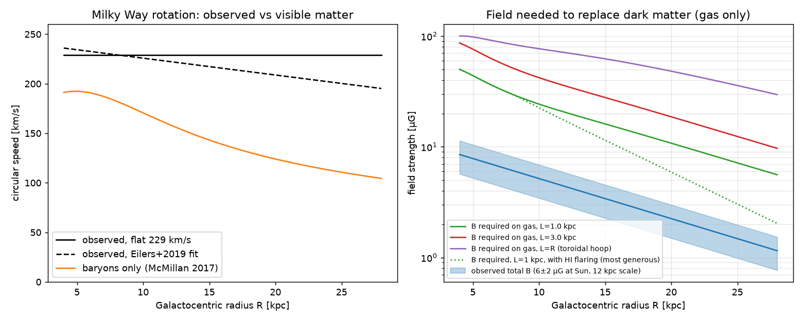
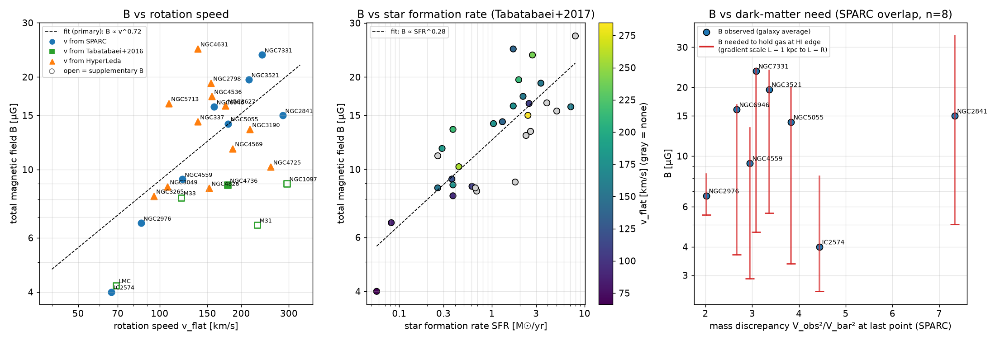

# QDM-NS Theory Notes

This document collects the equations of the **Quaternionic Dirac–Maxwell–Navier–Stokes (QDM-NS)** vortex model in one place, lists every symbol with its meaning, SI units and where it is defined in this repository, and records the open questions and observational checks that are needed to turn the framework into a quantitatively testable theory.

The intent is to keep the model as stated in [README.md](README.md). Where an interpretation had to be chosen, it is marked **(interpretation)**. Section 5 suggests one possible dimensionally consistent form; that is a proposal, not part of the model as currently stated.

Contents
1. [Model equations](#1-model-equations)
2. [Symbol table](#2-symbol-table)
3. [Open items: units and structure](#3-open-items-units-and-structure)
4. [How the simulation maps onto the equations](#4-how-the-simulation-maps-onto-the-equations)
5. [A possible dimensionally consistent form](#5-a-possible-dimensionally-consistent-form)
6. [Observational check 1: Milky Way magnetic support](#6-observational-check-1-milky-way-magnetic-support)
7. [Observational check 2: magnetic field vs rotation in 31 galaxies](#7-observational-check-2-magnetic-field-vs-rotation-in-31-galaxies)
8. [Next steps to make this testable](#8-next-steps-to-make-this-testable)
9. [References](#9-references)

---

## 1. Model equations

**State field** (README.md:94)

$$
\Psi = \psi + F + v \;\in\; \mathbb{H}(\mathbb{C})
$$

**Master operator** (README.md:104; also src/galaxy.rs:8, assets/shaders/galaxy_sim.wgsl:4)

$$
\mathcal{D}\Psi = \Big(\nabla + m_{\text{eff}} + \nu\nabla^{2} - \frac{D}{Dt}\Big)\Psi + \bar{\Psi}\cdot J + \lambda\big(\Psi\bar{\Psi}-1\big)\Psi
$$

The natural reading is that the field equation is $\mathcal{D}\Psi = 0$ **(interpretation)**. The README defines the operator but does not yet state what it equals.

**Steady axisymmetric galaxy ansatz** (README.md:123)

$$
v(r,\phi) = \omega(r)\,\hat{k} + \phi_0 \ln r
$$

**Spiral-arm locus** (README.md:129, as implemented in src/galaxy.rs)

$$
\theta_{\text{arm}}(r) = \phi_0 \ln r \quad\Longleftrightarrow\quad r(\theta) = r_0\, e^{\theta/\phi_0},
\qquad \phi_0 = \frac{2\pi}{\varphi^{2}} \approx 2.400\ \text{rad (golden angle)},
\qquad \varphi = \tfrac{1+\sqrt5}{2}
$$

The pitch angle of this spiral is $\arctan(1/\phi_0) \approx 22.6^\circ$. Other "golden" conventions give different spirals, and the repository currently uses two of them:

| Convention | $\phi_0$ | Pitch angle | Used in |
|---|---|---|---|
| Golden angle, $\phi_0 = 2\pi/\varphi^2$ | 2.400 | 22.6° | `src/galaxy.rs` (`GOLDEN_ANGLE`), initial layout in `gpu_galaxy.rs` |
| Growth by $\varphi$ per full turn, $\phi_0 = 2\pi/\ln\varphi$ | 13.06 | 4.38° | arm-restoring force in `assets/shaders/galaxy_sim.wgsl` |
| Growth by $\varphi$ per quarter turn ("golden spiral"), $\phi_0 = \pi/(2\ln\varphi)$ | 3.26 | 17.03° | — |

For comparison, the Milky Way's arms have a mean pitch of about 13° (Vallée 2015), and nearby spirals show a bimodal distribution peaking near 12° and 23° (Yu & Ho 2020).

**Earlier vector form** (README history, commit 65ecf28; the Z-pinch term is still quoted at README.md:164)

$$
\vec F_{\text{net}} = q(\vec v\times\vec B) + (\varphi\,\nabla\ln r)\,\hat\theta - \frac{\mu_0 I}{2\pi r}\,\hat r - \vec v\,\varphi^{-4}
$$

---

## 2. Symbol table

The units column gives SI units *if* a symbol has its standard physical meaning. Entries marked ⚠️ are listed in §3 as open items.

| Symbol | Meaning in the model | SI units | Defined at |
|---|---|---|---|
| $\Psi$ | unified state field $\psi + F + v$ | ⚠️ components have different units | README.md:94 |
| $\psi$ | Dirac-like wavefunction for macroscopic vortex "spin" | m$^{-3/2}$ for a normalised spinor **(interpretation)** | README.md:97 |
| $F$ | electromagnetic quaternion | V/m if $F = E + icB$ **(interpretation)** | README.md:98 |
| $v$ | fluid velocity quaternion | m/s | README.md:99 |
| $w$ | scalar part of the code's `FluxQuaternion`: "pressure / ether density / energy" | ⚠️ Pa, kg/m³ or J are different units; dimensionless in code | README.md:35, src/quaternion/math.rs:11 |
| $\mathbb{H}(\mathbb{C})$ | complex quaternions (biquaternions) | — | README.md:94 |
| $\mathcal{D}$ | QDM-NS operator (contains nonlinear terms) | — | README.md:104 |
| $\nabla$ | "Dirac + Maxwell core" | m$^{-1}$; ⚠️ spatial or 4-gradient not yet specified | README.md:109 |
| $m_{\text{eff}}$ | effective mass from baryonic density and self-gravity | kg as a mass; needs $m c/\hbar$ [m$^{-1}$] next to $\nabla$ ⚠️ | README.md:110, code `m_eff` (gpu_galaxy.rs) |
| $\nu$ | quaternion viscosity | m²/s (kinematic viscosity) ⚠️ | README.md:111; `NU` src/galaxy.rs:41 |
| $D/Dt$ | material derivative $\partial_t + v\cdot\nabla$ | s$^{-1}$ ⚠️ | README.md:112 |
| $\bar\Psi$ | quaternion conjugate | as $\Psi$; ⚠️ which conjugation in $\mathbb{H}(\mathbb{C})$ | README.md:104 |
| $\cdot$ in $\bar\Psi\cdot J$ | product (Hamilton, scalar part, or dot product?) | — ⚠️ | README.md:113 |
| $J$ | current density (Birkeland / Z-pinch arms) | A/m² **(interpretation)**; ⚠️ no equation determines it | README.md:113 |
| $\lambda$ | vorticity-threshold brake / jet trigger | m$^{-1}$ to match $\nabla$ ⚠️ | README.md:114 |
| $\omega$ | vorticity $\lvert\operatorname{Im}(\nabla\Psi)\rvert$; also angular velocity $\omega(r)$ in the ansatz | s$^{-1}$ ⚠️ one symbol, two uses | README.md:114, :123 |
| $\phi$ | azimuthal angle in README.md:123 | rad ⚠️ shares a letter with the golden ratio | README.md:123 |
| $\theta$ | azimuthal angle in the spiral formula | rad | README.md:129 |
| $\varphi$ | golden ratio $(1+\sqrt5)/2$ | dimensionless | README.md:131, `phi_value` |
| $\phi_0$ | arm winding coefficient $\theta_{\text{arm}} = \phi_0\ln r$ | rad | README.md:130, `GOLDEN_ANGLE` src/galaxy.rs:23 |
| $r_0$ | spiral scale radius | m | README.md:129 |
| $\varphi^{-4}$ | "golden drag" coefficient | s$^{-1}$ in code | galaxy_sim.wgsl:144, `PHI_INV_4` ether_compute.wgsl:12 |
| $q, \vec B, \mu_0, I$ | charge, magnetic field, vacuum permeability, current | C, T, T·m/A, A | README history; README.md:164 |
| `PINCH`, `pinch_strength` | code coupling standing in for $\bar\Psi\cdot J$ | dimensionless (code units) | src/galaxy.rs:39; gpu_galaxy.rs |
| `GM_CORE`, `EPS_CORE` | Plummer core GM and softening (code units) | — | src/galaxy.rs:26, :28 |

---

## 3. Open items: units and structure

These are the main places where the framework would need to be pinned down before it can make quantitative predictions.

**3.1 Dimensional consistency of the master equation.** Every term must share the units of $\nabla\Psi$, i.e. $[\Psi]\,\mathrm{m^{-1}}$.

| Term | Units as written | Matches $[\Psi]/\mathrm m$? | What would fix it |
|---|---|---|---|
| $\nabla\Psi$ | $[\Psi]/\mathrm m$ | reference | — |
| $m_{\text{eff}}\Psi$ | $\mathrm{kg}\,[\Psi]$ | no | use $m_{\text{eff}}c/\hbar$ |
| $\nu\nabla^2\Psi$ | $[\Psi]/\mathrm s$ | no (off by a velocity) | use $\nu/c$ |
| $\tfrac{D}{Dt}\Psi$ | $[\Psi]/\mathrm s$ | no (off by a velocity) | use $\tfrac1c\tfrac{D}{Dt}$ |
| $\bar\Psi\cdot J$ | $[\Psi]\,\mathrm{A/m^2}$ | no | introduce a coupling constant |
| $\lambda(\Psi\bar\Psi-1)\Psi$ | the "$-1$" requires $\Psi\bar\Psi$ dimensionless | only if $\Psi$ is dimensionless | normalise $\Psi$ by reference scales |

The sum $\Psi = \psi + F + v$ also adds quantities with different units (m$^{-3/2}$ + V/m + m/s). The quaternion algebra fixes how quantities multiply, but it does not assign physical units. Explicit scale factors are needed, as in §5.

**3.2 Structural items**
- **Field equation.** State what $\mathcal{D}\Psi$ equals (presumably $0$, or a source term).
- **Definition of $\nabla$.** If it is the 4-gradient $\tfrac1c\partial_t + \mathbf i\partial_x + \mathbf j\partial_y + \mathbf k\partial_z$ (needed for the Dirac and Maxwell limits), the $\partial_t$ inside $D/Dt$ counts the time derivative twice.
- **Closure for $J$.** Relate $J$ to $F$ (Maxwell: $\nabla\cdot E = \rho_e/\epsilon_0$, $\nabla\times B = \mu_0 J + \dots$) or give its own equation. The physical Lorentz force density is $\rho_e E + J\times B$, which involves $F$ rather than all of $\Psi$.
- **Gravity.** No potential, metric or $G$ appears in $\mathcal{D}$. A Dirac mass term does not by itself produce an attraction between distant masses. The "GR-like weak-field limit via $m_{\text{eff}}$" (README.md:152) needs an explicit derivation.
- **Limits.** Show explicitly that the equations reduce to the Dirac, Maxwell and Navier–Stokes equations in the stated limits. Because $\psi$ alone can occupy all 8 real components of $\mathbb{H}(\mathbb{C})$, a sum $\psi + F + v$ does not automatically separate into three equations.
- **λ term.** The README describes it as variational. Writing down the Lagrangian would make that explicit.
- **Ansatz.** In $v = \omega(r)\hat k + \phi_0\ln r$, $\omega(r)$ is an angular velocity (s$^{-1}$), not a velocity, and $\ln r$ needs a reference length ($\ln(r/r_0)$). A purely rotational velocity would be the pure vector $v = r\,\Omega(r)\,\hat\phi$.
- **Parameters.** README.md:153 says $\nu$, $\lambda$, $m_{\text{eff}}$ are fixed by observations. Quoting the observed values and the resulting numbers would let the predictions be checked.

---

## 4. How the simulation maps onto the equations

The running program is `src/main.rs` → `src/galaxy.rs` (CPU particles) → `src/hurricane_3d/renderer.rs`. The Bevy-based code in `src/simulation/` and `assets/shaders/galaxy_sim.wgsl` is not currently part of the build. The simulation is a visualisation driven by forces chosen to represent each term. It is not a numerical solution of $\mathcal{D}\Psi = 0$.

| Operator term | What the code does | Where |
|---|---|---|
| gravity (not in $\mathcal D$) | Plummer potential, GM = 4000, ε = 8 (code units). This gives a falling, Keplerian-like rotation curve at large r | src/galaxy.rs:60-72, :316-334 |
| $\nu\nabla^2\Psi$ | relaxes each star's velocity toward the Plummer circular speed | src/galaxy.rs:337-345 |
| $\nabla\Psi$ / $\bar\Psi\cdot J$ | tangential force pushing stars toward the arm $\theta = \phi_0\ln r$ | src/galaxy.rs:347-354; galaxy_sim.wgsl:113-122 |
| global damping | 6 %/s velocity damping | src/galaxy.rs:357-362 |
| $\bar\Psi\cdot J$ "Coriolis" | small rotation of the velocity vector about the spin axis | src/galaxy.rs:364-372 |
| $m_{\text{eff}}\Psi$ | relaxation toward tangential motion (Bevy shader) | galaxy_sim.wgsl:129 |
| $-D/Dt$ | linear drag $-\varphi^{-4}v$ (Bevy shader) | galaxy_sim.wgsl:145 |
| $\lambda(\Psi\bar\Psi-1)\Psi$ | drag proportional to $\lvert\Psi\rvert^2 - 1$ (Bevy shader) | galaxy_sim.wgsl:153 |
| jets | particles at r < 2 (shader) or r < 3 (plasma.rs) are re-launched along ±y at speed 80 | galaxy_sim.wgsl:87-90; src/simulation/plasma.rs:104-112 |

Points to keep in mind when reading the simulation as evidence:
- The golden-ratio spiral is an input. Stars are initialised on $\theta = \phi_0\ln r$ and the arm force pulls them back onto it. The older "sensitivity analysis" multiplies the force by $\exp[-1000(\varphi-1.618)^2]$ (src/simulation/plasma.rs:6, :123). Showing that φ is an attractor would need a run where the spiral is not built into the forces.
- No electric or magnetic field is computed anywhere yet. The flat rotation curve in the Bevy path is an initial condition: a constant tangential speed of 15 at every radius (gpu_galaxy.rs:177).
- A headless run of `src/galaxy.rs` (60,000 stars, 120 s) starts on the falling Plummer curve. The disc then gradually loses rotation ($v_t/v_c$ falls to 0.2–0.5) and stars drift inward. Galactic dynamics are not tuned in this regime, so this mainly shows the sim is not yet a rotation-curve model.
- Known open TODOs in code: the Bevy init uses $\phi_0 = 2\pi/\varphi^2$ while its shader uses $2\pi/\ln\varphi$. The $\phi_0\ln r$ "scalar part" of $v(r,\phi)$ is stored as vertical velocity `vel.y` (gpu_galaxy.rs:178-188).

---

## 5. A possible dimensionally consistent form

*This is a suggestion that keeps the term list.* Normalise each part of $\Psi$ by a reference scale and use the 4-gradient:

$$
\hat\Psi = \frac{\psi}{\psi_0} + \frac{E + icB}{E_0} + \frac{v}{c},\qquad
\nabla \equiv \tfrac1c\partial_t + \mathbf i\,\partial_x + \mathbf j\,\partial_y + \mathbf k\,\partial_z
$$

$$
\Big(\nabla + \frac{m_{\text{eff}}c}{\hbar} + \frac{\nu}{c}\nabla_{\!s}^{2} - \frac{1}{c}\,\mathbf v\!\cdot\!\nabla_{\!s}\Big)\hat\Psi
\;+\; \kappa\,\mathrm{Sc}\!\big(\bar{\hat\Psi}\,\hat J\big)
\;+\; \frac{1}{\ell_\lambda}\big(\hat\Psi\bar{\hat\Psi}-1\big)\hat\Psi \;=\; 0
$$

Here $\nabla_s$ is the spatial gradient (the $\partial_t$ of $D/Dt$ is already inside $\nabla$), $\hat J$ is a dimensionless current, $\kappa$ has units m$^{-1}$, $\ell_\lambda$ is a length, and $\mathrm{Sc}$ is the scalar part. Every term then has units m$^{-1}$. The items in §3.2 (closure for $J$, gravity, explicit limits, Lagrangian) would still need to be supplied.

---

## 6. Observational check 1: Milky Way magnetic support

**Question.** Can the Milky Way's measured magnetic field supply the extra inward force that visible matter cannot, so that no dark halo is needed?

**Inputs**
- Baryonic mass model: McMillan (2017). Visible matter alone gives $v_{\text{bar}} = 181$ km/s at the Sun.
- Rotation curve: flat 229 km/s, and the Eilers et al. (2019) fit $229 - 1.7\,(R-8.1)$ km/s.
- Total field: $6\pm2$ µG near the Sun and $10\pm3$ µG at 3 kpc, with a 12 kpc radial scale length (Beck 2001; Beck & Wielebinski 2013).
- Outer-disc HI flaring: Kalberla & Kerp (2009).

**Method.** The missing acceleration is $\Delta a = (v_{\text{obs}}^2 - v_{\text{bar}}^2)/R$. The field needed to supply it to the gas is $B_{\text{req}} = \sqrt{\mu_0\,\rho_{\text{gas}}\,\Delta a\,L}$, where $L$ is the length over which the field changes.

| R | Δa needed | B observed | B needed, L = 1 kpc | B needed, L = 3 kpc | B needed, L = R (toroidal hoop stress) | Needed / observed |
|---|---|---|---|---|---|---|
| 8.2 kpc | 7.8×10⁻¹¹ m/s² | 6.0 µG | 29 µG | 50 µG | 83 µG | 5–14× |
| 15 kpc | 6.9×10⁻¹¹ m/s² | 3.4 µG | 16 µG (12 with HI flaring) | 28 µG (20) | 62 µG (44) | 3.4–18× |
| 25 kpc | 5.2×10⁻¹¹ m/s² | 1.5 µG | 7.2 µG (3.0) | 12 µG (5.3) | 36 µG (15) | 2–24× |

**Further considerations**
- Magnetic forces act on the ionised gas, not on stars. The Eilers rotation curve is traced by stars, which also carry most of the visible mass. Supporting all baryons at the Sun would need about 80 µG.
- A toroidal field that falls off outward as observed pulls inward only inside about 12 kpc, and pushes outward beyond that.
- Energy budget. Near the Sun $B^2/2\mu_0 \approx 0.9$ eV/cm³, while the gas's rotational kinetic energy density is about 460 eV/cm³. Out to 30 kpc the field holds $\sim10^{49}$ J. The missing mass inside 25 kpc ($2.3\times10^{11}\,M_\odot$) corresponds to $\sim2\times10^{52}$ J.
- In the virial theorem, magnetic energy enters with the same sign as pressure. A self-contained field pushes a system apart unless external currents confine it.

Reproduce with `analysis/mw_magnetic_check.py`.

---

## 7. Observational check 2: magnetic field vs rotation in 31 galaxies

**Question.** If magnetic support replaced dark matter, galaxies that need more extra support should have stronger fields.

**Data**
- Fields: galaxy-averaged equipartition total field strengths for 31 galaxies measured with one consistent method (Tabatabaei et al. 2017, which also provides SFR).
- Rotation speeds, in order of preference: SPARC $V_{\text{flat}}$ (Lelli et al. 2016); Tabatabaei et al. (2016); HyperLeda `vrot` only when the inclination is at least 40°.
- Mass discrepancy $V_{\text{obs}}^2/V_{\text{bar}}^2$ at the last measured point: SPARC mass models (8 galaxies overlap).
- Table: `analysis/galaxy_B_vrot.csv` (missing values left blank).

| Test | n | Pearson r (log) | Spearman ρ | Slope |
|---|---|---|---|---|
| B vs rotation speed | 21 | 0.60 (p = 0.004) | 0.44 (p = 0.04) | $B \propto v^{0.72\pm0.22}$ |
| B vs SFR | 30 | 0.83 | 0.77 | $B \propto \mathrm{SFR}^{0.28\pm0.04}$ |
| B vs mass discrepancy | 8 | 0.06 (p = 0.89) | −0.02 | flat |

- **Rotation speed and SFR.** Faster rotators do have somewhat stronger fields. Holding total SFR fixed weakens the B–rotation link to a partial Spearman of 0.29 (p = 0.21), but holding SFR per unit disc area fixed does not (0.57). Part of the B–SFR link comes from the method itself, because equipartition fields are derived from radio emission that tracks star formation.
- **Dark-matter need.** The field does not track the mass discrepancy. The most dark-matter-dominated systems in the sample (IC 2574, LMC) have the weakest fields (~4 µG).
- **Energy ratio.** The magnetic energy density is typically 2–5 % of the gas's rotational kinetic energy density.
- **Gas at the HI edge.** Where the gas surface density falls to 1 M☉/pc², holding up the gas alone would need 3–34 µG. That is comparable to galaxy-*averaged* fields, but the field at those radii is not measured and is expected to be weaker.
- **Literature interpretation.** Tabatabaei et al. (2016) found a tight polarized-flux–rotation correlation and no link with angular speed or shear. They interpret it as gas compression and shear in more massive galaxies ordering a field that is tied to the gas, with ordered magnetic energy ≈ 0.002 of rotational energy. Van Eck et al. (2015) found no B–rotation correlation but clear correlations with molecular gas and SFR. Both read the field as following the dynamics and star formation rather than driving rotation.

Reproduce with `analysis/fetch_data.sh` then `analysis/galaxy_B_vrot.py`.

---

## 8. Next steps to make this testable

1. **Write the field equation** with "= 0" (or a source), define $\nabla$, $\bar\Psi$ and "·", and fix the units of every term (e.g. as in §5).
2. **Close the system.** Give the equation that determines $J$ from $F$ and the plasma, and state where gravity enters.
3. **Derive the limits.** Show the reductions to Dirac, Maxwell and Navier–Stokes explicitly, plus the claimed weak-field gravity limit.
4. **Predict a rotation curve.** From the baryonic mass of a real galaxy (e.g. a SPARC galaxy), compute the predicted $B(R)$ and $v(R)$, then compare with the measured rotation curve and the measured field.
5. **Explain stellar rotation.** Rotation curves traced by stars, which feel no Lorentz force, need a mechanism in the model.
6. **Lensing and large-scale evidence.** State what the model predicts for gravitational lensing, the Bullet Cluster and the CMB acoustic peaks.
7. **Golden-ratio attractor.** Do a linear stability analysis of the steady state, or run a simulation with no golden-ratio input (remove the arm-restoring force and the resonance factor), and see which pitch angle emerges. Compare with the observed 12°/23° bimodality.
8. **Jets.** Derive the jet trigger from the λ term instead of the current `r < 2` relaunch, and compare the predicted jet power scaling with data.

---

## 9. References

- Beck, R. 2001, Space Sci. Rev. 99, 243 — Galactic and extragalactic magnetic fields
- Beck, R. & Wielebinski, R. 2013, Planets, Stars and Stellar Systems Vol. 5, 641 — Magnetic fields in galaxies
- Beck, R. 2015, A&ARv 24, 4 — Magnetic fields in spiral galaxies
- Basu, A. & Roy, S. 2013, MNRAS 433, 1675 — Magnetic fields in nearby normal galaxies: energy equipartition
- Eilers, A.-C. et al. 2019, ApJ 871, 120 — The circular velocity curve of the Milky Way from 5 to 25 kpc
- Kalberla, P. M. W. & Kerp, J. 2009, ARA&A 47, 27 — The HI distribution of the Milky Way
- Lelli, F., McGaugh, S. S. & Schombert, J. M. 2016, AJ 152, 157 — SPARC
- Makarov, D. et al. 2014, A&A 570, A13 — HyperLeda
- McMillan, P. J. 2017, MNRAS 465, 76 — The mass distribution and gravitational potential of the Milky Way
- Tabatabaei, F. S. et al. 2013, A&A 557, A129 — Multi-scale radio–infrared correlations in M31 and M33
- Tabatabaei, F. S. et al. 2016, ApJL 818, L10 — An empirical relation between the large-scale magnetic field and the dynamical mass in galaxies
- Tabatabaei, F. S. et al. 2017, ApJ 836, 185 — The radio spectral energy distribution and star formation rate calibration in galaxies
- Vallée, J. P. 2015, MNRAS 450, 4277 — Different studies of the global pitch angle of the Milky Way's spiral arms
- Van Eck, C. L. et al. 2015, ApJ 799, 35 — Magnetic fields in a sample of nearby spiral galaxies
- Yu, S.-Y. & Ho, L. C. 2020, ApJ 900, 150 — The statistical properties of spiral arms in nearby disk galaxies
